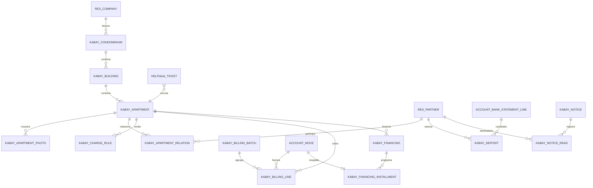

# Arquitectura inicial de Kabay Group

## Alcance y evaluación de estándar

| Requisito | Función estándar de Odoo | Extensión o brecha | Módulo responsable | Prueba prevista |
|---|---|---|---|---|
| Condominio, edificio y apartamento | `res.company`, `res.partner`, contactos/direcciones | Jerarquía residencial, códigos y atributos de unidad | `kabay_base` | Jerarquía válida y relaciones cruzadas rechazadas |
| Fotografías de apartamento | `ir.attachment` | Asociación tipada y máximo 10 en servidor | `kabay_base` | Diez aceptadas, once rechazadas; unidades ilimitadas |
| Propietarios, inquilinos y residentes | `res.partner`, Contacts y Mail | `kabay.apartment.relation`, historial, roles, fechas, compañía y participación | `kabay_residents` | Roles, unidades múltiples, períodos, cierre, porcentajes, ACL, compañía y vistas en ambos sentidos |
| Cuotas y cuentas por cobrar | Accounting: `account.move`, pagos y conciliación | Reglas, lotes, preview e idempotencia | `kabay_billing` | Repetición no duplica; residual coincide con Accounting |
| Financiamiento de compra | Accounting invoices | Contrato y cuotas numeradas enlazadas a facturas | `kabay_financing` | Calendario, inicial, parcial y progreso completo |
| Reportes de depósitos | Accounting/bank reconciliation | Declaración, comprobante y revisión sin pago automático | `kabay_deposits` | Reporte no paga; movimiento no se aplica dos veces |
| Avisos y lecturas | Mail, Website y portal | Audiencia por condo/torre/rol y lectura individual | `kabay_notices` | Solo audiencia elegible y publicación programada |
| Incidencias | Enterprise Helpdesk, Mail, Activities | Enlace condominio/edificio/unidad y permisos portal | `kabay_helpdesk` | Ticket visible solo a contactos autorizados |
| Portal privado | Portal, Website y QWeb | Validación por relación vigente en cada registro/documento | `kabay_portal` | Manipulación de IDs no expone información ajena |
| Reportes | Accounting, Helpdesk y ORM | Vistas/indicadores navegables | `kabay_reports` | Valores coinciden con modelos fuente |
| Actividades internas | `mail.activity` | Enlace desde registros Kabay si hace falta | Módulo dueño del registro | Permisos y trazabilidad |

La especificación identifica `industry_real_estate` como posible punto de evaluación, orientado a gestión inmobiliaria y alquileres; no hay evidencia en el runtime actual de que esté instalado o cubra cuotas comunitarias, relaciones históricas y conciliación. No se añade ninguna dependencia de terceros.

## Diagrama ER



`ACCOUNT_MOVE` es la fuente de verdad de facturas, notas de crédito y saldos. El esquema omite campos estándar y relaciones de audiencia que se detallarán al construir esos módulos.

## Dependencias

```text
kabay_base
  ├── kabay_residents ──> base + contacts + mail
  ├── kabay_billing ──> kabay_residents
  ├── kabay_financing ──> kabay_residents + account
  ├── kabay_deposits ──> kabay_residents + account
  ├── kabay_notices ──> kabay_residents + mail
  └── kabay_helpdesk ──> kabay_residents + helpdesk + mail
kabay_portal ──> kabay_residents + kabay_billing + kabay_deposits + kabay_notices + kabay_helpdesk + portal + website
kabay_reports ──> kabay_billing + kabay_deposits + kabay_helpdesk + account
```

Las dependencias opcionales deben declararse solo tras verificar que los módulos Enterprise están disponibles en el servidor. `kabay_base` no depende de módulos contables ni Helpdesk.

## Esquema inicial

```text
kabay.condominium
  name, code, street/city/state/country, company_id, manager_id, active
kabay.building
  name, code, condominium_id, notes, active
kabay.apartment
  name, code, building_id, condominium_id (related/store), floor, unit_type,
  area, coefficient, notes, active
kabay.apartment.photo
  name, apartment_id, image (private attachment), sequence
kabay.apartment.relation
  partner_id, apartment_id, role, date_start, date_end, ownership_share,
  state, active, notes, company_id (related/store)
```

## Plan de migración y despliegue

1. La ruta local ya está conectada a `addons_path`; se creó un respaldo PostgreSQL previo a esta fase en `backups/kabay_dev_pre_residents.dump`.
2. Se verificaron Odoo `19.0-20261112`, Enterprise y PostgreSQL `17.12`; confirmar compañía y zona horaria al preparar datos reales.
3. `kabay_base` y `kabay_residents` están instalados en `kabay_dev`; las pruebas de estructura, seguridad y relaciones pasaron.
4. Importar primero condominios, luego edificios y apartamentos con claves externas y validar unicidad/jerarquía.
5. Crear contactos y relaciones históricas sin alterar documentos contables existentes.
6. Configurar compañías, moneda, impuestos, diarios y cuentas desde Odoo con validación fiscal local antes de cualquier facturación.
7. Añadir módulos por dependencia, migrar datos con respaldo y pruebas, y conciliar conteos/residuales contra fuentes Odoo.
8. Desplegar en ventana controlada con respaldo recuperable; no publicar portal ni procesos automáticos hasta validar reglas de acceso e idempotencia.

## Roles y límites de seguridad implementados

`kabay_base` define Administrador, Finanzas, Recepción, Mantenimiento y Gerencia. Administrador implica los cuatro roles funcionales, de modo que sus menús, ACL y permisos de vistas coinciden en todos los módulos. Puede crear y mantener estructura, pero no eliminar registros. Los cuatro roles funcionales por separado pueden leer la estructura dentro de sus compañías permitidas y no escribirla. `kabay_residents` permite escritura de relaciones solo al administrador. Usuarios de Ajustes heredan el grupo Administrador. Finanzas habilita las operaciones contables previstas por los módulos de Kabay; las reglas multiempresa siguen restringiendo registros a las compañías habilitadas para el usuario.

Las compañías de edificios, apartamentos, fotos y relaciones se heredan desde el condominio/unidad. Los contactos globales (`company_id` vacío) se admiten; un contacto asignado a una compañía distinta de la unidad se rechaza.

Las relaciones del mismo contacto, unidad y rol no pueden solaparse. Roles distintos pueden coexistir; el negocio aún debe confirmar si hay combinaciones que deban prohibirse. Las fechas son inclusivas, por lo que la siguiente relación comienza al día posterior a la fecha final anterior. Las participaciones son opcionales; cuando alguna está configurada, los propietarios de cada período deben sumar 100 % al confirmar.

## Referencia visual del prototipo

El HTML presenta una interfaz de administración con barra superior, navegación lateral, indicadores, listados, formularios y flujos para condominios/unidades, personal, cuotas, avisos, solicitudes y mantenimiento; incorpora un portal con navegación, tarjetas de resumen, perfil, depósitos y solicitudes. Su implementación usa almacenamiento de navegador e interacciones locales. Estos elementos sirven como orientación visual y de navegación, no como persistencia, control de acceso ni lógica contable de producción.
